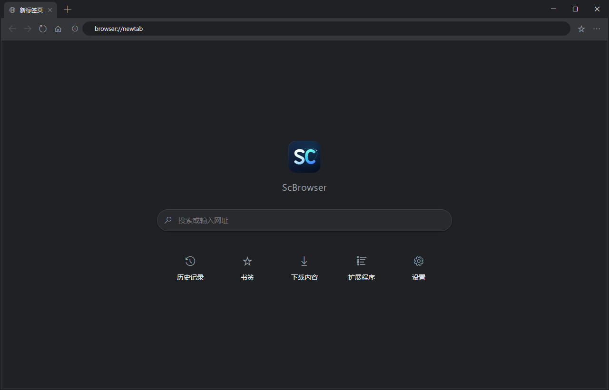

<div align="center">
  
  <h1>ScBrowser</h1>
  <p>基于 <b>WPF + Microsoft Edge WebView2</b> 的 Windows 桌面浏览器，支持 Chrome 扩展</p>

[](#系统要求)
[](#从源码构建)
[](../../releases/latest)
[](LICENSE)



</div>

ScBrowser 是一个从零写起的通用浏览器外壳：**外壳用 WPF 原生控件**（而不是再开一个 WebView 承载 UI），
网页内容与内部页面由 **WebView2** 承载，每个标签页一个独立的 WebView2 实例。
它同时支持加载 **Chrome 扩展**（含 `.crx` 自动解包），并让**深浅主题贯通到网页内容**。

> 参考项目：[MicrosoftEdge/WebView2Browser](https://github.com/MicrosoftEdge/WebView2Browser)（C++ Win32 示例）。
> 本项目沿用其多 WebView 思路，但在技术栈与架构上做了三处关键调整——外壳改 WPF 原生、引入分层架构与依赖注入、
> 存储改 SQLite。理由见 [`docs/01-技术栈说明.md`](docs/01-技术栈说明.md)。

## 特性

**浏览**
- 多标签：新建 / 关闭（含鼠标中键）/ 切换 / **左键拖拽重排**（跟手 + 实时让位）/ 标签右键菜单
- 无边框自绘外壳：窗口按钮并入标签条，标签条可拖拽、贴靠（Aero Snap）、双击最大化
- **`Ctrl+Shift+T` 重开已关闭的标签页**；窗口尺寸与位置记忆
- 前进 / 后退 / 刷新与停止 / 主页 / 页面缩放 / 页内错误提示条

**地址栏**
- 网址与搜索词自动判定，聚焦即全选
- **历史下拉**：按输入实时过滤（地址前缀 > 标题前缀 > 包含，同档优先常访问），
  ↑/↓ 选择、Enter 打开、Esc 收起；另有「使用 XX 搜索 / 直接打开」一行
- 页面安全状态图标（HTTPS / HTTP / 危险，悬停有中文说明）

**多窗口**
- `Ctrl+N` 新窗口、`Ctrl+Shift+N` **无痕窗口**（标签条带「无痕」徽标）
- 无痕窗口不记录历史、不保存会话、下载不入库，Cookie 与站点数据关闭即弃

**数据**
- 历史记录（去重 + 访问计数 + 关键字搜索）、书签（`Ctrl+D` 一键收藏）、下载（进度实时展示）
- 内部页面：新标签页 / 历史 / 书签 / 下载 / 扩展程序 / 设置，全部是随程序分发的本地 WebUI
- 会话保存与恢复（退出时记住打开的标签页）

**扩展与主题**
- 加载已解压扩展、安装 `.crx`（自动解包）、启用停用、卸载
- 深浅主题热切换，**同步影响网页的 `prefers-color-scheme`**（支持深色的站点自动变深，不做强制反色）
  与 WebView2 的默认底色——深色下新建标签不会白闪

## 下载安装

前往 [Releases](../../releases/latest) 下载（`ScBrowser-vX.Y.Z-win-x64-*.zip`，解压即用）：

| 包 | 体积 | 前置条件 |
|---|---|---|
| `selfcontained` | ~145 MB | **无**（自带 .NET 运行时） |
| `frameworkdep` | 几 MB | 需自行安装 [.NET 10 桌面运行时](https://dotnet.microsoft.com/download/dotnet/10.0) |

首次运行可能遇到 Windows SmartScreen 提示（本程序未做代码签名）：
点「更多信息」→「仍要运行」即可。

### 系统要求

- **Windows 10 1809+ / Windows 11**
- **WebView2 运行时**：Win10/11 通常已随 Edge 预装；若缺失，从
  [微软官网](https://developer.microsoft.com/microsoft-edge/webview2/) 安装 Evergreen 版

## 快捷键

| 快捷键 | 作用 | 快捷键 | 作用 |
|---|---|---|---|
| `Ctrl+T` | 新建标签页 | `Ctrl+Shift+T` | 重开已关闭的标签页 |
| `Ctrl+W` | 关闭标签页 | `Ctrl+Tab` / `Ctrl+Shift+Tab` | 下一个 / 上一个标签页 |
| `Ctrl+N` | 新建窗口 | `Ctrl+Shift+N` | 新建无痕窗口 |
| `Ctrl+L` / `Alt+D` | 聚焦地址栏（全选并展开历史下拉） | `Ctrl+R` / `F5` | 刷新 |
| `Ctrl+Shift+R` | 强制刷新（忽略缓存） | `Ctrl+D` | 收藏当前页 |
| `Ctrl+H` | 历史记录 | `Ctrl+J` | 下载内容 |
| `Alt+←` / `Alt+→` | 后退 / 前进 | `Ctrl+1..8` / `Ctrl+9` | 切换到第 N 个 / 最后一个标签页 |
| `Ctrl++` / `Ctrl+-` / `Ctrl+0` | 放大 / 缩小 / 重置缩放 | `Esc` | 停止加载 / 放弃地址栏编辑 |
| `Ctrl+F` | 页内查找 | `F3` / `Shift+F3` | 下一个 / 上一个匹配 |

> 焦点在网页里时快捷键同样生效（实现方式见 [`ARCHITECTURE.md`](ARCHITECTURE.md) §3.3）。

## 从源码构建

前置：[.NET 10 SDK](https://dotnet.microsoft.com/download/dotnet/10.0)。

```bash
sh manager.sh build     # 构建（Debug）
sh manager.sh run       # 前台运行
sh manager.sh test      # 单元测试
sh manager.sh verify    # 提交前闸门：构建(-warnaserror) + 单测 + 文档体检
sh manager.sh package   # 打包到 dist/（dev zip + release 可运行目录 / zip / setup）
```

**不装 bash 也能用**：仓库根提供等价的 Windows 批处理脚本 `build.bat` / `run.bat` / `test.bat` /
`verify.bat` / `clean.bat` / `package.bat` / `ci.bat`（纯 cmd + dotnet；`ci.bat` 一键跑完
「清理 → 闸门 → 打包」）。`manager.sh` 是命令语义的单一来源，两者保持同步。

**打包产物**（`dist/` 已加入 `.gitignore`，`clean` 会保留成品包）：

- `dist/dev/ScBrowser_<版本>_x64-unpack-debug.zip`：Debug 免安装包（框架依赖），
  内含 `ScBrowser.pdb`、`logs/`（本次发布日志）与 `build-info.txt`；
  zip 内带单一根目录 `ScBrowser_<版本>_x64-unpack-debug/`。
- `dist/release/unpack/`：Release 免安装目录（自包含，
  目标机无需安装 .NET 运行时），里面的 `ScBrowser.exe` 可直接双击运行。
- `dist/release/ScBrowser_<版本>_x64-unpack.zip`：上述目录的压缩包。
  **zip 根下直接是程序文件，不再套一层版本目录**，解压即可运行。
- `dist/release/ScBrowser_<版本>_x64-setup.exe`：Windows 安装程序，按用户安装到
  `%LOCALAPPDATA%\Programs\ScBrowser`，无需管理员权限，自带卸载与快捷方式。
  安装程序工具链由 NuGet 包 `Tools.InnoSetup` 还原，不需要手动安装 Inno Setup。

> dev 的 zip 内带单一根目录，release 的 zip 不带顶层目录；两者解压后都直接双击
> `ScBrowser.exe` 即可。

也可以直接用 Visual Studio 2022（17.13+）打开 `sc-browser.slnx` 构建运行。

## 项目结构

```
src/ScBrowser/            # WPF 应用
  Browser/                #   引擎层：WebView2 环境与标签页、导航、扩展、内部页面注册
  Services/               #   服务层：窗口总管、设置、主题、会话、下载、地址栏建议
  Storage/                #   存储层：SQLite（历史 / 书签 / 下载）
  ViewModels/ Views/      #   外壳层：视图模型与 WPF 视图
  Assets/ui/              #   内部页面 WebUI（HTML/CSS/JS）
  Interop/                #   Win32 互操作（DWM、最大化钉工作区）
tests/ScBrowser.Tests/    # xUnit 单元测试
samples/extensions/       # 示例 Chrome 扩展（验证扩展加载链路）
docs/                     # 面向使用者/维护者的文档；icons/ 是应用图标的矢量设计源
```

## 技术栈与设计取舍

C# / .NET 10（`net10.0-windows`）· WPF（外壳 UI）· Microsoft Edge WebView2（网页与内部页面）
· SQLite（历史/书签/下载）· 原生 HTML/JS/CSS（内部页面 WebUI）。

几个刻意的选择（完整理由见 [`docs/01-技术栈说明.md`](docs/01-技术栈说明.md) 与
[`ARCHITECTURE.md`](ARCHITECTURE.md) §7）：

- **外壳用 WPF 原生控件**，不为 UI 再开一个 WebView——省一整套 WebView 环境，
  焦点/输入法/无障碍/DPI 也更省心。
- **每个标签页一个 WebView2**（不做单实例复用）：换来切换零延迟与页面状态保留，代价是内存。
- **全应用只有一个 `CoreWebView2Environment`**：所有标签共享 Cookie/缓存/扩展安装态；
  无痕窗口也复用同一环境，只换 InPrivate 的 profile。
- **内部页面走消息桥**而不是 `fetch` 直连宿主（见 `ARCHITECTURE.md` §3.1）。
- 自绘外壳的两个已知坑（最大化被裁边、缩放命中带被 WebView2 吃掉）都在 §7 记了正确做法。

## 文档

| 文档 | 内容 |
|---|---|
| [`docs/01-技术栈说明.md`](docs/01-技术栈说明.md) | 技术栈选型理由与各组件分工 |
| [`docs/02-使用说明.md`](docs/02-使用说明.md) | 面向使用者的操作手册与排查手册 |
| [`ARCHITECTURE.md`](ARCHITECTURE.md) / [`arch/flows.md`](arch/flows.md) | 代码地图：文件职责、任务→代码位置、重点链路、易踩的坑 |
| [`ROADMAP.md`](ROADMAP.md) | 要做什么、做到哪了 |
| [`CHANGELOG.md`](CHANGELOG.md) | 每个版本的变化 |
| [`AGENTS.md`](AGENTS.md) | 本仓库的 AI 协作约定（改代码前先读） |
